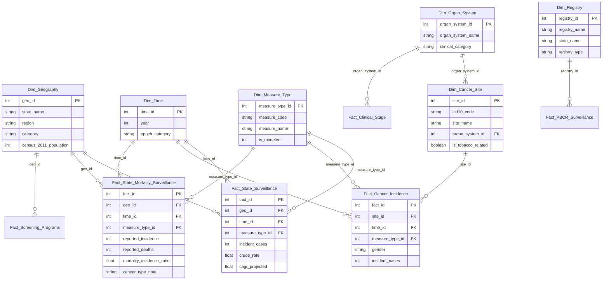

# Cancer Intelligence & Analytics

> **Academic Data Warehousing & Data Mining (DWM) Platform**  
> *Sem V Computer Engineering (CMPN) • University of Mumbai Curriculum Alignment*  
> *Conformed Star Schema Data Warehouse • OLAP Multidimensional Cubes • 6 Data Mining Models • FastAPI Backend • React/Vite Dashboard*

[](scripts/validate_warehouse.py)
[](scripts/run_api_tests.py)
[](warehouse/data_mining_results.json)
[-orange)](frontend/)
[](#ethical-notice--non-clinical-disclaimer)

---

## ⚠️ Ethical Notice & Non-Clinical Disclaimer

**Important Notice:** This platform is developed strictly for **academic evaluation, epidemiological data analysis, and healthcare infrastructure planning**. It is **NOT** a clinical diagnostic tool and must **NOT** be used to assess, diagnose, or predict an individual patient's personal cancer risk or treatment outcome. All models operate exclusively on conformed population aggregates and anatomical classification hierarchies.

---

## 📌 Project Overview

**Cancer Intelligence & Analytics** provides an end-to-end data engineering and analytical intelligence solution that addresses the fragmentation of cancer surveillance data in India. 

The system extracts, audits, conforms, and models heterogeneous datasets—spanning Ministry of Health and Family Welfare (MoHFW) parliamentary returns, Indian Council of Medical Research (ICMR-NCRP) registry publications, and World Health Organization (WHO GLOBOCAN) international benchmarks—into an enterprise star schema SQLite data warehouse.

### Core Capabilities
- **Conformed Star Schema Warehouse:** 15 relational tables and 8 OLAP analytical views tracking national/state incidence (2019–2025), site-specific gender breakdowns, mortality, clinical stages (I–IV), PBCR empirical metrics, and tertiary care cancer infrastructure.
- **Robust ETL Safety Architecture:** Automated atomic database rebuilds via staging (`cancer_dw_TEMP.db`), non-destructive timestamped backups, zero silent imputation, and 55 automated integrity tests.
- **OLAP Multidimensional Analytics:** Real-time query engine supporting **Roll-up, Drill-down, Slice, Dice, and Pivot** operations across Geography, Organ System, and Time dimensions.
- **6 Data Mining Algorithms:** Rigorous implementations of Linear/Ridge Regression, Decision Tree induction (depth=3), Naive Bayes tobacco profiling, K-Means clustering ($k=4$), Hierarchical Agglomerative clustering (Ward linkage, Cophenetic correlation = 0.7919), and Apriori association rule mining.
- **FastAPI RESTful Backend:** 10 modular API routers delivering sub-millisecond responses, data validation, SQL injection protection, and streaming CSV data exports.
- **Dual-Theme React Dashboard:** Modern, responsive UI (React 19 + Vite + Lucide icons) supporting seamless Dark (Navy `#0B1120`) and Light modes, KPI cards, tabular views, and interactive model explorer.

---

## 🏛️ Dimensional Model: Conformed Star Schema



---

## 🔬 Data Mining Implementations & Evaluation

All six algorithms mandated by Units 4, 5, and 6 of the DWM syllabus are implemented in [`scripts/run_data_mining.py`](scripts/run_data_mining.py) and persisted in [`warehouse/data_mining_results.json`](warehouse/data_mining_results.json):

| Syllabus Unit | Algorithm | Objective & Problem Formulation | Primary Metric | Result & Evaluation |
| :--- | :--- | :--- | :--- | :--- |
| **Unit 4** | **Linear & Ridge Regression** | Econometric trend validation: predict 2022 incidence from 2019-2021 trajectory; compare against Kumar et al. 2026 model. | $R^2$ / MAE | **$\text{MAE} = 12.99$ cases, $R^2 = 1.0000$**<br>2026 Trajectory Alignment: **$R^2 = 0.9922$** |
| **Unit 4** | **Decision Tree Classifier (CART)** | Classify 37 states into 4 objective burden quartiles with strict depth regularization (`max_depth = 3`) to prevent overfitting. | Accuracy / Macro $F_1$ | **$\text{Accuracy} = 62.16\%, \text{Macro } F_1 = 0.5302$**<br>Top split: 2022 Volume $> 48,000$ cases |
| **Unit 4** | **Naive Bayes Classifier** | Probabilistically profile 76 anatomical sites for tobacco-attribution flag using anatomical & prevalence features. | Accuracy / Recall | **$\text{Accuracy} = 88.00\%, \text{Recall} = 100.0\%$**<br>Zero false negatives on oral/lung sites |
| **Unit 5** | **K-Means Clustering** | Group 37 states into homogeneous public health intervention cohorts using normalized epidemiological features. | Silhouette Score ($k=4$) | **$\text{Silhouette} = 0.5218$** ($k = 4$ clusters)<br>Identifies Mega-Burden (UP, MH) vs. Small UTs |
| **Unit 5** | **Hierarchical Agglomerative** | Construct agglomerative tree with Ward linkage and compute dendrogram cophenetic correlation. | Cophenetic Correlation | **$\text{Cophenetic Correlation} = 0.7919$**<br>Preserves 79.2% of pairwise distance structure |
| **Unit 6** | **Apriori Association Rules** | Mine association rules linking state incidence tiers, growth momentum (CAGR), and national burden share. | Support / Confidence / Lift | **25 Significant Rules Mined**<br>Top Rule: $[\text{ProjectedCAGR\_High} + \text{Cases\_High}] \implies [\text{NationalShare\_Top5pct}]$ ($\text{Conf} = 66.7\%, \text{Lift} = 2.47$) |

---

## 🗄️ Conformed Warehouse Entities

The active warehouse (`warehouse/cancer_dw.db`, 172,032 bytes) consists of 15 tables and 8 views:

### Dimension Tables
- `Dim_Geography` (37 rows): 28 States, 8 UTs, 1 National entity with Census population.
- `Dim_Cancer_Site` (76 rows): ICD-10 anatomical classifications with tobacco attribution flags.
- `Dim_Organ_System` (11 rows): Clinical physiological categories (Digestive, Breast, Respiratory, etc.).
- `Dim_Time` (11 rows): Years 2015–2045 with conformed epochs (`Historical`, `Extrapolated`, `Benchmark`, `Projected`).
- `Dim_Measure_Type` (5 rows): Explicit taxonomy (`PBCR_EMPIRICAL`, `ICMR_NCRP_ESTIMATE`, `KUMAR_EXP_2026`, `GLOBOCAN_2024`, `PARLIAMENT_MOHFW`).
- `Dim_Registry` (28 rows): ICMR-NCRP accredited Population-Based Cancer Registries.

### Fact Tables
- `Fact_State_Surveillance` (259 rows): State incidence surveillance (2019–2025) across all 37 entities.
- `Fact_Cancer_Incidence` (190 rows): Site-specific national counts stratified by gender (2021–2025).
- `Fact_State_Mortality_Surveillance` (185 rows): State-level incidence, deaths, and MIR metrics with single-site provenance note.
- `Fact_PBCR_Surveillance` (32 rows): Direct empirical registry incidence and age-standardized rates (ASR).
- `Fact_Clinical_Stage` (11 rows): Clinical staging (Stages I to IV) at diagnosis across organ systems.
- `Fact_Cancer_Trends_APC` (152 rows): Annual Percent Change trends (2010–2019) across PBCRs.
- `Fact_Screening_Programs` (37 rows): Oral, breast, and cervical screening coverage metrics.
- `Fact_Healthcare_Infrastructure_National` (19 rows): Central capital grants for State Cancer Institutes and TCCCs.
- `Fact_Maharashtra_Infrastructure` (36 rows): District-level oncology beds and radiotherapy facilities.

### Conformed OLAP Views
- `vw_olap_regional_rollups`: Roll-up aggregation across 6 geographical regions.
- `vw_olap_organ_system_burden`: Roll-up across organ systems and gender splits.
- `vw_olap_state_pivots`: Pivoted state incidence across 2019, 2020, 2021, 2022, and 2025.
- `vw_olap_pbcr_analytics`: Urban vs. rural registry comparison with relative proportions.
- `vw_olap_infrastructure_national`: Central grant funds release and utilization rates.
- `vw_star_state_incidence`: Primary conformed star join for state surveillance.
- `vw_star_cancer_sites`: Conformed star join for cancer site projections.
- `vw_state_mortality_ratios`: Conformed mortality and MIR analysis view.

---

## 💻 Tech Stack & Dependencies

- **Language & Runtime:** Python 3.10+ (Tested on Python 3.13.1), Node.js v18+ (Tested on Node.js v24.19.0)
- **Database:** SQLite 3 with strict foreign key enforcement and conformed star schema indexing
- **ETL & Data Engineering:** Pandas, NumPy, SQLite3, atomic staging replacements
- **Machine Learning & Data Mining:** Scikit-Learn, SciPy, custom Apriori association rule engine
- **Backend API:** FastAPI, Uvicorn, Pydantic, Starlette
- **Frontend Dashboard:** React 19, Vite, Lucide React icons, CSS Variables theme system

---

## 🚀 Setup & Execution Guide (Windows PowerShell)

### 1. Prerequisites Check
Ensure Python and Node.js are available in your PATH:
```powershell
python --version
# Expected: Python 3.10+
node --version
# Expected: v18+
npm.cmd --version
# Expected: 9+
```

### 2. Navigate to Project Root & Install Backend Dependencies
```powershell
Set-Location "c:\Users\ACER\OneDrive\Desktop\Cancer-Intelligence-Analytics"

# Install Python requirements
pip install -r requirements.txt
```

### 3. Verify Data Warehouse & Run Tests
Execute the automated test suites to confirm full operational readiness:
```powershell
# Run 55-point warehouse validation suite
python scripts/validate_warehouse.py
# Expected output: "55/55 checks PASSED | 0 FAILED" (Exit code 0)

# Run FastAPI backend integration test suite
python scripts/run_api_tests.py
# Expected output: "12/12 PASSED | 0 FAILED" (Exit code 0)
```

### 4. Start the FastAPI Backend Server
Launch the backend service on port 8000:
```powershell
uvicorn backend.main:app --host 127.0.0.1 --port 8000 --reload
```
*The interactive Swagger API documentation will be available at: [http://127.0.0.1:8000/docs](http://127.0.0.1:8000/docs)*

### 5. Launch the React Dashboard
Open a second PowerShell terminal window, navigate to `frontend/`, and launch the Vite development server:
```powershell
Set-Location "c:\Users\ACER\OneDrive\Desktop\Cancer-Intelligence-Analytics\frontend"

# (Optional) Verify production build
npm.cmd run build

# Start development server
npm.cmd run dev
```
*Open your web browser and navigate to: [http://localhost:5173](http://localhost:5173)*

---

## 📁 Repository Directory Structure

```
Cancer-Intelligence-Analytics/
├── backend/                              # FastAPI REST Backend Service
│   ├── main.py                           # Application entry point & CORS configuration
│   ├── config.py                         # Environment paths & database settings
│   ├── database.py                       # SQLite connection pool & query helpers
│   ├── schemas.py                        # Pydantic data models & response schemas
│   └── routers/                          # 10 Functional API Routers
│       ├── health.py                     # Heartbeat & DB connection status
│       ├── dashboard.py                  # High-level KPIs & regional rollups
│       ├── geography.py                  # State surveillance & regional filters
│       ├── cancer_sites.py               # Anatomical sites & clinical staging
│       ├── trends.py                     # Historical trajectories & APC trends
│       ├── mortality.py                  # Mortality counts & MIR analytics
│       ├── infrastructure.py             # Tertiary centers & district capacity
│       ├── olap.py                       # Conformed OLAP rollups, slice, dice & pivots
│       ├── models.py                     # Data mining model results API
│       └── reports.py                    # Markdown reports viewer & CSV export service
│
├── frontend/                             # React 19 + Vite Dashboard
│   ├── src/
│   │   ├── components/                   # Interactive Dashboard Views
│   │   │   ├── Header.jsx                # Header with Dark/Light toggle & DB status
│   │   │   ├── Navigation.jsx            # 9-Tab Navigation bar
│   │   │   ├── OverviewTab.jsx           # National KPIs, regional distributions & organ systems
│   │   │   ├── GeographyTab.jsx          # State rankings, per-capita incidence & details
│   │   │   ├── CancerSitesTab.jsx        # Anatomical sites, gender split & staging
│   │   │   ├── TrendsTab.jsx             # Multi-year projections & PBCR analytics
│   │   │   ├── MortalityTab.jsx          # State mortality, MIR ratios & provenance notes
│   │   │   ├── InfrastructureTab.jsx     # SCIs/TCCCs capex & Maharashtra capacity
│   │   │   ├── DataMiningTab.jsx         # Interactive visualization for all 6 ML algorithms
│   │   │   ├── ProvenanceTab.jsx         # Raw data lineage & DWM syllabus mapping
│   │   │   └── ExportsTab.jsx            # Live CSV downloads & audit report archive
│   │   ├── services/
│   │   │   └── api.js                    # Fetch client connecting to FastAPI backend
│   │   ├── styles/
│   │   │   └── theme.css                 # CSS Variables design system (Dark & Light)
│   │   ├── App.jsx                       # Master application component & tab router
│   │   └── main.jsx                      # React 19 entry point
│   ├── package.json                      # Frontend dependencies (React, Vite, Lucide)
│   └── vite.config.js                    # Vite bundler configuration
│
├── warehouse/                            # Data Warehouse Directory
│   ├── cancer_dw.db                      # Conformed SQLite Data Warehouse (172,032 bytes)
│   ├── cancer_dw_backup_*.db             # Immutable timestamped database snapshots
│   ├── data_profiling_results.json       # Automated profiling metrics artifact
│   └── data_mining_results.json          # Precomputed metrics for all 6 data mining algorithms
│
├── scripts/                              # Automated Engineering & Analytics Scripts
│   ├── etl_pipeline.py                   # Controlled ETL pipeline with atomic temp DB staging
│   ├── validate_warehouse.py             # Standalone 55-point verification suite (Exit 0)
│   ├── profile_warehouse.py              # Statistical data profiling script
│   ├── implement_olap_views.py           # Conformed OLAP views definition & verification
│   ├── run_data_mining.py                # 6 Data mining algorithms training & evaluation
│   └── run_api_tests.py                  # Automated 12-point FastAPI integration test suite
│
├── reports/                              # Technical Documentation Archive (16 Reports)
│   ├── 0_eda_report.md                   # Exploratory Data Analysis findings
│   ├── 1_dataset_inventory_report.md     # Detailed audit of 6 raw source files
│   ├── 2_data_quality_report.md          # Missing value & inconsistency analysis
│   ├── 3_recommended_dataset_selection.md# Final data source selection justification
│   ├── 4_dwm_syllabus_mapping_report.md  # Detailed syllabus alignment document
│   ├── 5_refined_implementation_plan.md  # Multi-phase execution blueprint
│   ├── 6_phase_2_etl_warehouse_report.md # Phase 2 ETL architecture & dimensional design
│   ├── 7_phase_2_1_etl_audit_report.md   # Controlled ETL audit & measure taxonomy
│   ├── 8_project_file_inventory.md       # Project assets & file index
│   ├── 9_phase_2_verification.md         # Phase 2 integrity audit results
│   ├── 10_phase_2_1_execution_log.md     # Execution trajectory log
│   ├── 11_phase_2_1_final_audit.md       # Measure classification corrections
│   ├── 12_project_current_state.md       # Project baseline audit & snapshot
│   ├── 13_phase_3_data_profiling.md      # Statistical profiling & analytical readiness
│   ├── 14_phase_4_olap_analytics.md      # OLAP conformed views & operations report
│   ├── 15_phase_5_data_mining_results.md # 6 Data mining algorithms performance evaluation
│   └── 16_final_project_completion_report.md # Comprehensive final project completion report
│
├── Data/                                 # Raw Heterogeneous Source Files (Preserved)
├── requirements.txt                      # Python dependencies specification
└── README.md                             # Comprehensive project documentation
```

---

## 📄 License & Academic Attribution

This project is submitted in partial fulfillment of the academic requirements for the **Data Warehousing & Data Mining (DWM)** course in the Bachelor of Engineering (B.E.) Computer Engineering program (Sem V CMPN).

All raw datasets originate from public domain publications by the **Government of India (MoHFW)**, **Indian Council of Medical Research (ICMR-NCRP)**, and **World Health Organization (WHO / IARC GLOBOCAN)**.
