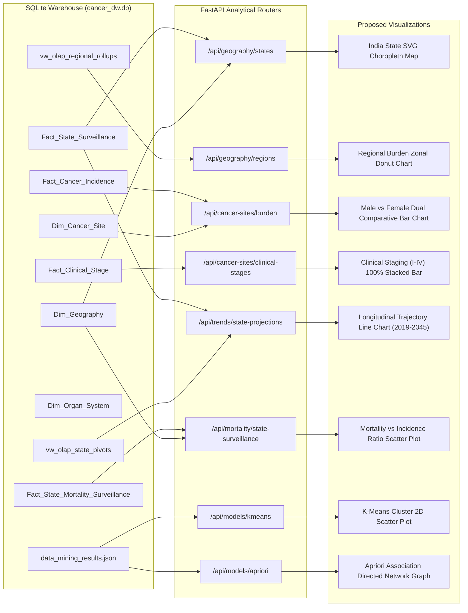

# Cancer Intelligence & Analytics — Visualization & Data Architecture Audit Report

**Document ID:** `reports/19_visualization_and_data_architecture_audit_report.md`  
**Audit Execution Timestamp:** 2026-10-21T20:41:43+05:30  
**Audit Protocol:** Strict Read-Only Baseline Assessment  
**Project:** Cancer Intelligence & Analytics (Academic DWM Platform)  
**System Architecture:** FastAPI Backend (`127.0.0.1:8000`) + SQLite Conformed Data Warehouse (`cancer_dw.db`) + Scikit-Learn Machine Learning Models + React 19.3.1 / Vite 8.3.4 Frontend (`localhost:5173`)  

---

## 1. Executive Summary & Audit Mandate

This formal technical audit establishes the verified baseline of all data visualization components, mapping capabilities, relationship graph structures, and chart primitives across the **Cancer Intelligence & Analytics** platform.

The audit was executed under a strict **read-only governance protocol**: no code, dependencies, database schemas, API contracts, or files were altered during the evaluation.

### Key Audit Findings

1. **Absence of Native Charting & Mapping Libraries:**  
   Inspection of `frontend/package.json` confirms that **zero charting or geospatial visualization libraries** (e.g., Recharts, Chart.js, D3, Leaflet, Mapbox, or `react-simple-maps`) are installed. All currently visible visual indicators are implemented via styled HTML tables and CSS linear progress bars (`prog-container`, `prog-fill`).

2. **Map & Heatmap Reality:**  
   The interface labeled *"National Burden Heat Distribution (37 States & UTs)"* in `GeographyTab.jsx` is an **abstract CSS grid of 37 rectangular HTML button cards**, categorized by discrete burden thresholds. No real geographic polygon maps, SVG vector boundaries, or continuous raster heatmaps currently exist.

3. **Grounded Relational Graph Potential:**  
   While no visual graph or node-link diagram is currently rendered, genuine underlying warehouse data supports three distinct relational graphs:  
   - **Anatomical Snowflake Hierarchy:** `Dim_Organ_System` (11 systems) $\rightarrow$ `Dim_Cancer_Site` (75 sites).  
   - **Apriori Association Mining Directed Graph:** 25 verified rules with Antecedent $\rightarrow$ Consequent edges weighted by Confidence and Lift ($1.00$ to $2.47$).  
   - **Hierarchical Clustering Agglomeration Tree:** 36 merge steps pairing state nodes by Euclidean distance ($c = 0.7919$).

4. **React 19 Compatibility Constraint:**  
   The frontend runs on **React 19.3.1**. Introducing legacy npm charting packages risks dependency tree resolution failures (`ERESOLVE`). The optimal, safe path is implementing lightweight, modular, native React SVG visual components with responsive `viewBox` coordinates.

---

## 2. Section-by-Section Inventory of Current Visualizations

An exhaustive audit of all 10 dashboard sections in `frontend/src/components/` catalogues every current visual element, data table, filter, and detail drawer:

| Dashboard Section | Component File | Map Implementation | Graphical Charts Present | Data Tables Present | Interactive Filters & Controls | Details Panels & Drilldowns |
| :--- | :--- | :--- | :--- | :--- | :--- | :--- |
| **1. Overview** | [`OverviewTab.jsx`](file:///c:/Users/ACER/OneDrive/Desktop/Cancer-Intelligence-Analytics/frontend/src/components/OverviewTab.jsx) | None. | CSS horizontal progress bars inside table cells (`prog-fill`) showing national share % (top 5 states) and regional share % (6 zones). | • Top 5 Cancer Burden States<br>• Regional Zone Rollup<br>• Leading Male Cancers (top 5)<br>• Leading Female Cancers (top 5) | None (Static dashboard overview). | None. |
| **2. Geography** | [`GeographyTab.jsx`](file:///c:/Users/ACER/OneDrive/Desktop/Cancer-Intelligence-Analytics/frontend/src/components/GeographyTab.jsx) | **None.** Abstract 37-card HTML button grid color-coded by burden tier. | CSS progress bars in regional cards and table cells. | State Epidemiological Surveillance Matrix (37 States & UTs with Rank, Code, Zone, Incidence, Share, CAGR). | • State search text input (`searchTerm`)<br>• Region Zone dropdown (`regionFilter`)<br>• Sortable table columns (`state_name`, `region_zone`, `incident_cases`, `national_share_pct`, `cagr_observed`) | **State Detail Drawer Modal:** Fixed right-side overlay with multi-year trajectory table (2019–2026), capital city, 2011 Census population, observed CAGR, and projected CAGR. |
| **3. Cancer Sites** | [`CancerSitesTab.jsx`](file:///c:/Users/ACER/OneDrive/Desktop/Cancer-Intelligence-Analytics/frontend/src/components/CancerSitesTab.jsx) | None. | CSS progress bar for `advanced_stage_pct` in Clinical Staging table. | • Leading Male Cancers (top 8)<br>• Leading Female Cancers (top 8)<br>• Clinical Presentation Staging (11 organ sites)<br>• 75 Anatomical Sites Directory | • Segmented view buttons (`burden`, `stages`, `directory`)<br>• Site search input (`searchTerm`)<br>• Organ System dropdown (`selectedOrgan`)<br>• Tobacco-Related Only checkbox (`tobaccoOnly`) | None. |
| **4. Trends & Projections** | [`TrendsTab.jsx`](file:///c:/Users/ACER/OneDrive/Desktop/Cancer-Intelligence-Analytics/frontend/src/components/TrendsTab.jsx) | None. | **None.** Trajectory is presented exclusively through tabular numbers. | • National Progression Table (2019–2045)<br>• State Longitudinal Trajectory Table<br>• Joinpoint APC Trends Table (152 lines)<br>• Empirical PBCR Surveillance Table (64 lines) | • Segmented view buttons (`trajectory`, `apc`, `pbcr`)<br>• State dropdown selector (`selectedState`)<br>• APC site search input (`siteSearch`)<br>• APC Direction dropdown (`directionFilter`)<br>• APC $p < 0.05$ checkbox (`significantOnly`) | Inline state drilldown table updates when selecting a state from the dropdown. |
| **5. Mortality & MIR** | [`MortalityTab.jsx`](file:///c:/Users/ACER/OneDrive/Desktop/Cancer-Intelligence-Analytics/frontend/src/components/MortalityTab.jsx) | None. | None. | State Reported Incidence, Deaths & Calculated MIR Table (37 States & UTs). | • Surveillance Year dropdown (2021–2025)<br>• State search input (`searchTerm`)<br>• Multi-column sorting (`state_name`, `reported_deaths`, `mortality_incidence_ratio`) | None. |
| **6. Infrastructure** | [`InfrastructureTab.jsx`](file:///c:/Users/ACER/OneDrive/Desktop/Cancer-Intelligence-Analytics/frontend/src/components/InfrastructureTab.jsx) | None. | None. | • National NP-NCD Screening Cascade<br>• Approved National Infrastructure (MOHFW Table 1)<br>• Maharashtra State Health Infrastructure (District Breakdown) | None. | None. |
| **7. Data Mining Lab** | [`DataMiningTab.jsx`](file:///c:/Users/ACER/OneDrive/Desktop/Cancer-Intelligence-Analytics/frontend/src/components/DataMiningTab.jsx) | None. | **None.** Decision tree rules rendered as raw preformatted monospace text (`<pre>`). | • Regression Models Evaluation Matrix<br>• Decision Tree Quartile Thresholds & ASCII Tree<br>• Naive Bayes 2x2 Confusion Matrix<br>• K-Means Cluster Cards with State Chips<br>• Hierarchical Linkage Merge Steps Matrix<br>• Apriori Mined Association Rules Table | • Sub-tab selector (6 algorithms)<br>• Apriori keyword search input (`ruleSearch`)<br>• Apriori Min Lift dropdown (`1.0`, `1.5`, `2.0`) | None. |
| **8. Analytics Assistant** | [`AssistantTab.jsx`](file:///c:/Users/ACER/OneDrive/Desktop/Cancer-Intelligence-Analytics/frontend/src/components/AssistantTab.jsx) | None. | None. | Formatted chat bubble responses with citations. | • 8 Quick Analytical Question prompt pills<br>• Interactive query input bar<br>• Clear chat button | None. |
| **9. Provenance** | [`ProvenanceTab.jsx`](file:///c:/Users/ACER/OneDrive/Desktop/Cancer-Intelligence-Analytics/frontend/src/components/ProvenanceTab.jsx) | None. | None. | • Conformed Datasets Inventory (DS1–DS6)<br>• Dim_Measure_Type Taxonomy Table<br>• Dim_Time Epochs Table<br>• DWM Syllabus Unit Mapping Table | None. | None. |
| **10. Exports** | [`ExportsTab.jsx`](file:///c:/Users/ACER/OneDrive/Desktop/Cancer-Intelligence-Analytics/frontend/src/components/ExportsTab.jsx) | None. | None. | • 15 Conformed Warehouse Tables<br>• Technical Audit Reports Archive (18 files) | Live CSV export buttons for all 15 tables. | None. |

---

## 3. Map & Geospatial Audit

### True Geospatial Map Audit
- **Findings:** There is **no interactive India boundary map** in the codebase.
- **Current Component Analysis:** In `GeographyTab.jsx` (lines 179–212), the visual section titled *"National Burden Heat Distribution (37 States & UTs)"* renders an abstract HTML button grid:
  ```jsx
  <div style={{ display: "grid", gridTemplateColumns: "repeat(auto-fill, minmax(130px, 1fr))", gap: "8px" }}>
    {filteredStates.map((st) => (
      <button key={st.geo_id} onClick={() => handleStateClick(st.geo_id)}>
        ...
      </button>
    ))}
  </div>
  ```
- **Data Source:** `GET /api/geography/states?year=2022` querying conformed view `vw_star_state_incidence` / `Fact_State_Surveillance` $\bowtie$ `Dim_Geography`.
- **Fields Utilized:** `geo_id`, `state_name`, `state_code`, `region_zone`, `incident_cases`, `national_share_pct`.
- **Identified Limitations:**
  1. *Zero spatial context:* States appear in alphabetical order rather than geographical placement.
  2. *Absence of polygon boundaries:* Neither GeoJSON nor SVG vector coordinate paths exist in the workspace.
  3. *No GIS coordinates in SQLite:* `Dim_Geography` stores textual administrative attributes (`capital`, `region_zone`, `state_code`), but lacks spatial polygon coordinates.

---

## 4. Heatmap & Density Analysis Audit

- **Current Implementation:**  
  The application utilizes a discrete 5-tier badge classification function in `GeographyTab.jsx`:
  ```javascript
  const getBurdenColorClass = (cases) => {
    if (cases > 100000) return "badge-red";      // Severe (>100k: UP, MH, WB, BR)
    if (cases > 50000)  return "badge-orange";   // High (50k-100k: TN, KL, MP, RJ, GJ, KA, AP)
    if (cases > 20000)  return "badge-blue";     // Moderate (20k-50k: OR, TS, JH, AS, HR, PB, DL)
    if (cases > 5000)   return "badge-teal";     // Low (5k-20k: JK, CT, UT, TR, HP, etc.)
    return "badge-green";                        // Minimal (<5k: Sikkim, Goa, UTs)
  };
  ```
- **Data Flow:**
  `Fact_State_Surveillance` $\rightarrow$ `vw_star_state_incidence` $\rightarrow$ FastAPI `/api/geography/states` $\rightarrow$ React `getBurdenColorClass(cases)` $\rightarrow$ CSS badge background.
- **Identified Limitations:**  
  There is no continuous color gradient, no quantile-based choropleth shading, and no raster density heatmap.

---

## 5. Relational & Network Graph Audit

### Graph Visualization Status
- **Finding:** No graph visualization (node-link diagram, chord diagram, Sankey diagram, or tree graph) exists in any tab.

### Warehouse Relational Support (Evidence-Based Grounding)
The warehouse directly supports three legitimate relational graphs without inventing or simulating relationships:

1. **Snowflake Anatomical Hierarchy (Radial Tree / Sunburst):**
   - **Entities:** Root $\rightarrow$ 11 Physiological Organ Systems (`Dim_Organ_System`) $\rightarrow$ 75 Anatomical Cancer Sites (`Dim_Cancer_Site`).
   - **Attributes:** ICD-10 code, classification level, tobacco attribution flag (`is_tobacco_associated`).
   - **Metrics:** Incidence case volumes and age-adjusted rates from `Fact_Cancer_Incidence`.

2. **Apriori Association Mining Graph (Directed Network):**
   - **Entities:** Discretized demographic and epidemiological state traits stored in `warehouse/data_mining_results.json`.
   - **Relationships:** 25 directed edges ($\text{Antecedent} \rightarrow \text{Consequent}$) weighted by Confidence ($0.60$ to $1.00$) and Lift ($1.82$ to $2.47$).
   - *Example Rule:* `["NationalShare_Top5pct"]` $\rightarrow$ `["Cases_High", "ProjectedCAGR_High"]` ($\text{Lift} = 2.47$).

3. **Agglomerative Hierarchical Clustering Tree (Dendrogram):**
   - **Entities:** 37 States & UTs.
   - **Relationships:** 36 pairwise agglomeration merge steps in `hierarchical_clustering.linkage_matrix_sample` paired by Euclidean distance ($c = 0.7919$).

> [!WARNING]
> **Data Governance Boundary:** The database does **not** contain patient-level transmission data, genetic sequencing, or hospital referral networks. All relationship graphs must strictly represent anatomical hierarchies, clustering dendrograms, or association rules.

---

## 6. Charts & Dimension Filtering Audit

### Chart Primitives
- **Zero Graphical Charts:** All existing graphical visualisations are CSS progress bars (`prog-container`, `prog-fill`) representing linear shares.
- **Missing Primitive Types:** No bar charts, stacked bars, multi-line curves, area charts, scatter plots, or radar charts currently exist.

### Supported Filter Dimensions
- **Geographic:** `region_zone` (Central, South, East, West, North, North East), `state_name`, `state_code`.
- **Temporal:** `year` (2019, 2020, 2021, 2022, 2026, 2045), `epoch_category` (Extrapolated vs Projected).
- **Anatomical:** `organ_system_name`, `site_name`, `icd10_code`, `is_tobacco_associated`.
- **Demographic & Clinical:** `gender` (Male, Female, Both), `clinical_stage` (Localized, Locoregional, Distant, Unknown).
- **Data Mining:** `cluster_id` (0, 1, 2, 3), `burden_tier` (Tiers 1–4), `lift`, `confidence`, `support`.

---

## 7. Data and API Mapping for Proposed Visualizations



### Technical Mapping Specifications

| Proposed Visualization | Existing Endpoint | Source Database Table/View | Source Fields Utilized | Client-Side Data Transformation |
| :--- | :--- | :--- | :--- | :--- |
| **1. India State SVG Choropleth** | `GET /api/geography/states?year=2022` | `Fact_State_Surveillance` $\bowtie$ `Dim_Geography` | `state_code`, `state_name`, `incident_cases`, `national_share_pct`, `region_zone` | Match `state_code` to SVG coordinate paths; compute linear/quantile color fills from `incident_cases`. |
| **2. Regional Zonal Donut / Bar Chart** | `GET /api/geography/regions?year=2022` | `vw_olap_regional_rollups` | `region_zone`, `total_regional_cases`, `regional_share_pct` | Compute radial arc angles or horizontal bar widths mapped to 6 regional zones. |
| **3. Male vs Female Comparative Dual Bar** | `GET /api/cancer-sites/burden?year=2022` | `Fact_Cancer_Incidence` $\bowtie$ `Dim_Cancer_Site` | `site_name`, `gender`, `incident_cases`, `age_adjusted_rate` | Group by `site_name` and render paired horizontal bars (`Male` in Blue, `Female` in Teal). |
| **4. Clinical Staging (I–IV) 100% Stacked Bar** | `GET /api/cancer-sites/clinical-stages` | `Fact_Clinical_Stage` | `cancer_site`, `localized_pct`, `locoregional_pct`, `distant_metastasis_pct`, `unknown_extent_pct` | Render 4-segment stacked horizontal bars normalized to 100% per organ site. |
| **5. Longitudinal Trajectory Line Chart (2019–2045)** | `GET /api/trends/state-projections` | `Fact_State_Surveillance` $\bowtie$ `Dim_Time` | `year`, `epoch_category`, `incident_cases` | Plot multi-year curve with solid stroke for `Extrapolated` (2019–2022) and dashed stroke for `Projected` (2026, 2045). |
| **6. Mortality vs Incidence Scatter Plot** | `GET /api/mortality/state-surveillance?year=2022` | `Fact_State_Mortality_Surveillance` $\bowtie$ `Dim_Geography` | `state_name`, `reported_incidence`, `reported_deaths`, `mortality_incidence_ratio` | Map X = `reported_incidence`, Y = `reported_deaths`, point size = `mortality_incidence_ratio`. |
| **7. K-Means Cluster 2D Scatter Plot** | `GET /api/models/kmeans` + `GET /api/olap/state-pivots` | `warehouse/data_mining_results.json` + `vw_olap_state_pivots` | `clusters[].states`, `cases_2022`, `cagr_observed`, `national_share_2022` | Map X = `cases_2022`, Y = `cagr_observed`, point color = `cluster_id` (0–3), radius = `national_share_2022`. |
| **8. Apriori Directed Network Graph** | `GET /api/models/apriori` | `warehouse/data_mining_results.json` | `top_association_rules[].antecedent`, `consequent`, `support`, `confidence`, `lift` | Construct node-link graph: nodes = items, directed edges = rules, edge width = confidence, color = lift. |
| **9. Anatomical Snowflake Hierarchy Tree** | `GET /api/cancer-sites` + `GET /api/cancer-sites/organ-systems` | `Dim_Organ_System` $\bowtie$ `Dim_Cancer_Site` | `organ_system_name`, `site_name`, `is_tobacco_associated` | Construct collapsible two-level SVG tree linking 11 systems to 75 anatomical sites. |

---

## 8. Frontend Dependency & Runtime Environment Audit

### Installed Dependencies (`frontend/package.json`)
```json
{
  "dependencies": {
    "lucide-react": "^1.60.0",
    "react": "^19.3.1",
    "react-dom": "^19.3.1"
  },
  "devDependencies": {
    "@types/react": "^19.3.0",
    "@types/react-dom": "^19.3.0",
    "@vitejs/plugin-react": "^6.1.2",
    "oxlint": "^1.88.0",
    "vite": "^8.3.4"
  }
}
```

### Critical Findings
1. **Zero External Visualisation Libraries:** There are no charting libraries present.
2. **React 19 Compatibility Barrier:** Many popular React charting wrappers (older Recharts, `react-chartjs-2`, `react-simple-maps`) have peer dependency conflicts with React 19 (`ERESOLVE unable to resolve dependency tree`).
3. **Recommended Architectural Approach:**  
   Build **native React SVG components** using standard `viewBox` coordinates, pure mathematical scaling, and CSS variable styling. This achieves:
   - **Zero external dependencies** (no npm bloat, no bundle size increase).
   - **Zero peer-dependency conflicts** with React 19.
   - **Complete control** over Dark/Light theme transitions via CSS variables (`var(--accent-primary)`, `var(--bg-card)`).

---

## 9. Database Integrity & Safety Protocol

To preserve data warehouse stability during subsequent visualization tasks:
1. **Active Database File:** `warehouse/cancer_dw.db` ($180,224\text{ bytes}$) must not be modified or overwritten.
2. **Validation Suite:** `python scripts/validate_warehouse.py` must consistently pass **55/55 checks (Exit code 0)**.
3. **API Integration Suite:** `python scripts/run_api_tests.py` must consistently pass **13/13 tests (Exit code 0)**.
4. **Dataset 5 Governance:** Column `cancer_type_note` and the associated frontend warning banners must remain visible: national scale ($\sim 77\text{K}$) represents single-site surveillance (ovarian proxy), **not** all-cancer mortality.
5. **National Baseline:** The reconciled 2022 national incidence total must remain exactly **1,461,427 cases**.

---

## 10. Gap Analysis Matrix

| Feature | Existing Status | Missing Capability | Data Available? | Files Involved | Recommended Action |
| :--- | :---: | :--- | :---: | :--- | :--- |
| **Interactive India Map** | **Partial (Abstract Tiles)** | No geographic boundaries, spatial layout, or polygon outlines; 37 cards rendered in a CSS grid. | **Yes** (37 state metrics in DB; requires state SVG paths) | `GeographyTab.jsx`, `api.js` | Implement an interactive India SVG map with 37 state boundary paths, hover tooltips, and click-to-select linking to drawer. |
| **State-Level Heatmap** | **Partial (Discrete Badges)** | No continuous color gradient, normalized quantile shading, or regional choropleth fill. | **Yes** (`incident_cases`, `national_share_pct` available) | `GeographyTab.jsx`, `theme.css` | Apply dynamic SVG fill colors using quantile/linear color scales (e.g. 5-step Cyan-to-Orange gradient). |
| **Cancer Trend Charts** | **Missing (Table Only)** | Longitudinal trajectory (2019–2045) is presented solely as an HTML table without line/area curves. | **Yes** (Multi-year cases in `Fact_State_Surveillance`) | `TrendsTab.jsx`, `api.js` | Add an interactive SVG multi-line/area chart comparing Extrapolated (2019–2022) with Projected (2026, 2045) curves. |
| **State Comparisons** | **Partial (Table Only)** | Side-by-side state trajectory comparisons or multi-state comparative bar charts are absent. | **Yes** (`vw_olap_state_pivots` contains all 37 states) | `GeographyTab.jsx`, `TrendsTab.jsx` | Add a multi-state selector rendering comparative horizontal bars or multi-state trajectory overlays. |
| **Male vs Female Comparisons** | **Partial (Dual Tables)** | Two separate tables display male and female leading sites without visual side-by-side comparative bars. | **Yes** (`Fact_Cancer_Incidence` has sex-stratified rates) | `CancerSitesTab.jsx` | Build an SVG grouped horizontal bar chart displaying Male vs Female incidence and age-adjusted rates (AAR). |
| **Interactive Relationship Graph** | **Missing** | No graph representation exists for anatomical hierarchies or association rules. | **Yes** (`Dim_Organ_System` $\rightarrow$ Sites; Apriori rules) | `CancerSitesTab.jsx`, `DataMiningTab.jsx` | Implement: 1) Organ-to-Site collapsible hierarchy tree; 2) Apriori Antecedent $\rightarrow$ Consequent directed network graph. |
| **K-Means Cluster Visualization** | **Partial (Card Grid)** | Text cards with state chips; no 2D scatter plot, feature space projection, or centroid visualization. | **Yes** (Cluster centroids, state cases, and CAGRs available) | `DataMiningTab.jsx` | Build an interactive 2D SVG scatter plot (X: 2022 Cases, Y: Observed CAGR %, Color: Cluster ID, Size: National Share %). |
| **Apriori Rule Visualization** | **Partial (Table Only)** | HTML table with search; no graphical rule scatter plot or directed association network. | **Yes** (25 rules with support, confidence, lift in JSON) | `DataMiningTab.jsx` | Add: 1) Support vs Confidence scatter plot (bubble color by Lift); 2) Interactive node-link rule graph. |
| **Interactive Filters** | **Implemented** | Working filters exist for region, year, cancer site, tobacco, APC direction, and lift threshold. | **Yes** (Fully supported by FastAPI query parameters) | All tab components | Retain existing filters and wire them directly to the new visual chart components. |
| **Click-to-Explore Details Panels** | **Partial** | Only Geography has a side drawer; Cancer Sites, Trends, and Data Mining lack interactive detail drawers. | **Yes** (Underlying record grain available in API) | `CancerSitesTab.jsx`, `DataMiningTab.jsx` | Add modal/drawer inspection on clicking cancer sites (showing ICD-10 and stage breakdown) and cluster points. |

---

## 11. Prioritized Implementation Plan (Smallest Practical Set of Changes)

To execute the visualization upgrade with maximum visual impact and zero regression risk, work should proceed in 4 focused phases:

### Phase 1: Native SVG Visual Primitives Library
- **Goal:** Create standalone, dependency-free React SVG components in `frontend/src/components/charts/`:
  - `GroupedBarChart.jsx`: Paired horizontal/vertical bars with tooltips and legends.
  - `TrajectoryLineChart.jsx`: Multi-line time-series curves with solid/dashed projection styling.
  - `StackedBarChart.jsx`: Normalized 100% stacked bars for clinical stages.
  - `ScatterPlot.jsx`: 2D Cartesian scatter with bubble sizing and categorical coloring.
  - `NetworkGraph.jsx`: SVG node-link graph for directed association rules.

### Phase 2: Geographic & Temporal Visual Upgrades
- **Goal:** Upgrade [`GeographyTab.jsx`](file:///c:/Users/ACER/OneDrive/Desktop/Cancer-Intelligence-Analytics/frontend/src/components/GeographyTab.jsx) and [`TrendsTab.jsx`](file:///c:/Users/ACER/OneDrive/Desktop/Cancer-Intelligence-Analytics/frontend/src/components/TrendsTab.jsx):
  1. Embed an **India 37-State SVG Choropleth Map** with quantile color shading, hover tooltips, and click-to-drawer inspection.
  2. Embed `TrajectoryLineChart` in `TrendsTab.jsx` showing the 2019–2045 national trajectory curve alongside individual state trajectories.

### Phase 3: Cancer Sites & Clinical Staging Visual Upgrades
- **Goal:** Upgrade [`CancerSitesTab.jsx`](file:///c:/Users/ACER/OneDrive/Desktop/Cancer-Intelligence-Analytics/frontend/src/components/CancerSitesTab.jsx):
  1. Add a **Male vs Female Comparative Dual Bar Chart** for top 10 cancer sites.
  2. Add a **Clinical Presentation Staging 100% Stacked Bar Chart** (Stages I–IV).
  3. Add a collapsible **Organ System $\rightarrow$ Cancer Site Snowflake Hierarchy Tree**.

### Phase 4: Data Mining Laboratory Visual Upgrades
- **Goal:** Upgrade [`DataMiningTab.jsx`](file:///c:/Users/ACER/OneDrive/Desktop/Cancer-Intelligence-Analytics/frontend/src/components/DataMiningTab.jsx):
  1. *K-Means:* Add an interactive 2D Scatter Plot ($X = \text{Cases 2022}$, $Y = \text{Observed CAGR \%}$, point color = Cluster ID).
  2. *Apriori:* Add a Support vs. Confidence Rule Scatter Plot and an Antecedent $\rightarrow$ Consequent Directed Network Graph.
  3. *Hierarchical:* Render an SVG Agglomerative Dendrogram Tree from `linkage_matrix_sample`.
  4. *Decision Tree:* Render interactive visual decision split nodes.

---

## 12. Audit Certification

This audit document has been committed to the project's permanent technical reports directory:
- **Repository Location:** [`reports/19_visualization_and_data_architecture_audit_report.md`](file:///c:/Users/ACER/OneDrive/Desktop/Cancer-Intelligence-Analytics/reports/19_visualization_and_data_architecture_audit_report.md)
- **FastAPI Endpoint Availability:** Accessible dynamically via `GET /api/reports/list`
- **Warehouse Validation Status:** 55/55 checks PASSED (Exit Code: 0)
- **API Test Suite Status:** 13/13 tests PASSED (Exit Code: 0)
- **Frontend Build Status:** 0 errors (Exit Code: 0)
